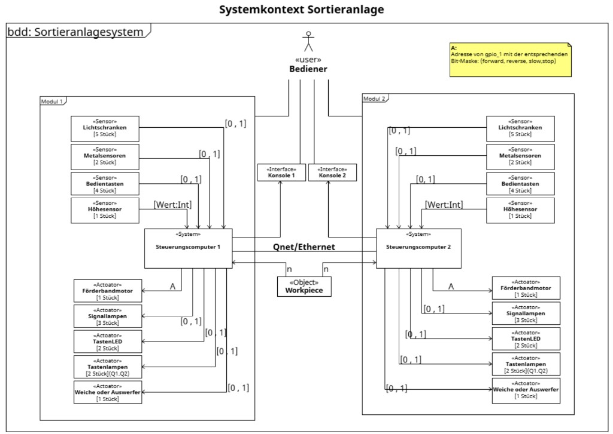
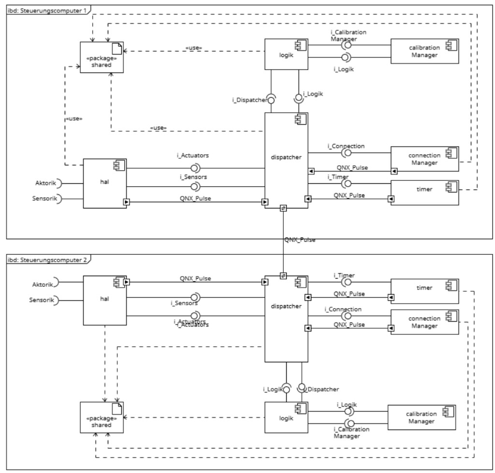

# Festo Conveyor Control

University team project for controlling two connected Festo conveyor modules with
**C++14 and QNX Neutrino**. The software identifies and sorts workpieces, handles
sensor events and calibration, and coordinates module handover through QNX pulses
over Qnet.

Developed for the Embedded System Engineering practicum at HAW Hamburg,
summer semester 2026, Team 3-3. This is laboratory control software, not a
certified industrial safety system.

## System Overview



Each module uses the same software structure: hardware abstraction, a central
dispatcher, hierarchical state machines, workpiece tracking, calibration,
timers and partner-connection management. The `-s` and `-c` options select the
front and rear conveyor positions; they do not imply a master/slave control
architecture.



## My Contribution

I implemented height sensor calibration and the ADC, and tested workpiece
classification on the physical conveyor. These contributions sit within the
team's wider control software and hardware integration work. I was also 
partially responsible for our system architecture and design.

Relevant implementation:
[height profile analysis](esep-SoSe26-3-3/src/hal/input_driver/profileAnalyzer.cpp).

## Build Requirements

- A QNX Software Development Platform environment providing `qcc` and the
  `gcc_ntoarmv7le` compiler variant, plus `make` and a compatible build shell.
- A matching QNX Neutrino ARMv7 target and the conveyor hardware interfaces used
  in the course laboratory.
- Qnet connectivity and the name-service configuration expected by the
  [connection implementation notes](esep-SoSe26-3-3/docs/CONNECTION_KONZEPT.md).
- For automated-test builds, Google Test and Google Mock headers and libraries
  compiled for the same QNX target.

The exact lab SDK/OS release is not recorded here. Compatibility must be checked
against the available lab installation. A normal Windows or Linux C++ compiler
alone cannot build or run this hardware-dependent application.

## Build and Run

Open a shell initialised for the installed QNX SDP. From the repository root:

```sh
cd esep-SoSe26-3-3
make PLATFORM=armv7le BUILD_PROFILE=debug
```

The default executable is:

```text
build/armv7le-debug/esep-SoSe26-3-3
```

Deploy that executable and its required runtime dependencies to each compatible
QNX target using the lab's deployment method. From the deployed binary's
directory, run on the respective targets:

```sh
# Front module
./esep-SoSe26-3-3 -s

# Rear module, on the other target
./esep-SoSe26-3-3 -c
```

These are target-side commands, not a laptop simulation. Device permissions,
network/name-service configuration and calibration must match the lab setup.
Follow the lab's hardware safety procedures; software E-stop handling is not a
substitute for an independently validated physical safety system.

## Testing

From `esep-SoSe26-3-3`, in the QNX build environment:

```sh
make tests
make calibration_manager_tests
make dispatcher_tests
```

These targets **build test executables; they do not execute them**. With default
build settings, the combined suite is
`build/armv7le-debug/esep-SoSe26-3-3_tests`. Deploy it to a compatible QNX target
and run it there:

```sh
./esep-SoSe26-3-3_tests
```

Separate manual-test build targets are `ejector_test`, `profile_analyzer_test`,
`dispatcher_hal_test` and `connection_gns_test`. They exercise hardware or
target services and require an appropriate lab configuration. Building a manual
test is not evidence that a hardware test has passed.

## Project Status and Limits

- The repository contains control code, automated tests, manual hardware tests
  and architecture documentation from the university project.
- Height calibration and workpiece classification were exercised on the
  conveyor during the project. This is not a claim that every requirement has
  been independently revalidated on the current checkout.
- A current full build and hardware acceptance run require the QNX lab
  environment. No portable simulator or hardware-free full-system demo is
  provided.
- Requirements in the detailed guide describe intended behaviour and must not
  be read as safety certification or a complete test report.

## Technical Documentation

- [Detailed architecture and requirements, in German](docs/technical-guide.md)
- [Connection and name-service design](esep-SoSe26-3-3/docs/CONNECTION_KONZEPT.md)
- [Workpiece handover](esep-SoSe26-3-3/docs/UEBERGABE_KONZEPT.md)
- [Workpiece tracking](esep-SoSe26-3-3/docs/WP_TRACKING_KONZEPT.md)
- [Error handling](esep-SoSe26-3-3/docs/ERROR_HANDLER_KONZEPT.md)
- [Build targets](esep-SoSe26-3-3/Makefile)

Original team development history is preserved. AI tools were used during
development. No software licence has been added to this repository.
