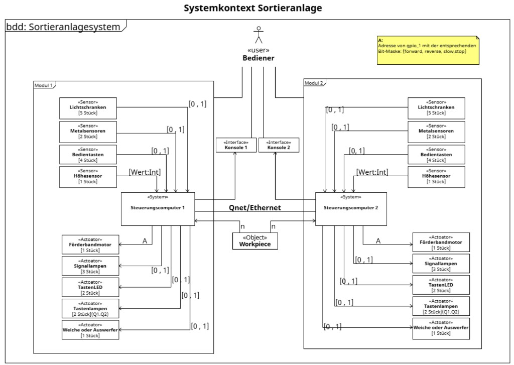
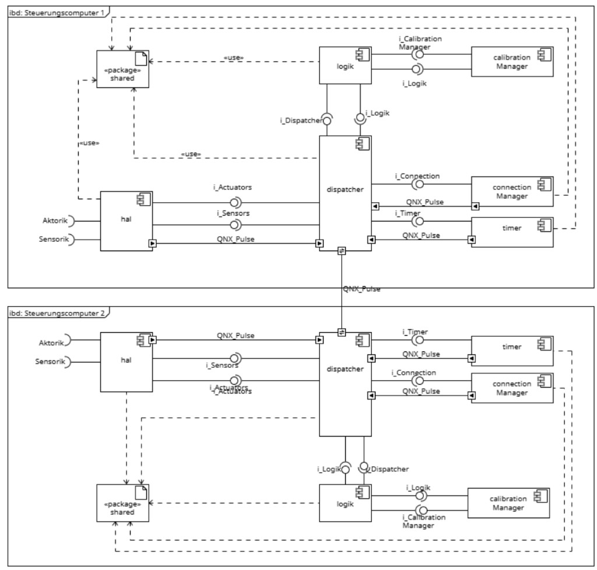

# ESEP SoSe 2026 — Team 3-3

Technische Referenz auf Deutsch. Die [Haupt-README](../README.md) enthält die englische Projektübersicht sowie Build- und Testhinweise. Die folgende Dateibaumdarstellung ist eine Architekturübersicht, keine vollständige Dateiliste. Anforderungen und Implementierungsnotizen sind kein Nachweis einer aktuellen Hardware-Abnahme.

Steuerungssoftware für die **Festo-Förderanlage** (QNX Neutrino, C++14).  
Zwei gleichwertige Teilanlagen (Modul 1 / Modul 2) sortieren Werkstücke und koordinieren sich **asynchron** per QNX-Pulse über Qnet.

| Anlage | Position | Start |
|--------|----------|-------|
| **Anlage 1** | Vorn | `./esep-SoSe26-3-3 -s` |
| **Anlage 2** | Hinten | `./esep-SoSe26-3-3 -c` |

Beide Steuerungsrechner sind **gleichwertige Master** — es gibt kein Master-Slave-Modell in der Logik.  
**Sortierweiche oder Auswerfer** hängt vom **physischen Aufbau** ab, nicht von der Anlagen-Nummer. Möglich sind z. B.:

- beide Module mit Weiche  
- beide Module mit Auswerfer  
- vorn Weiche, hinten Auswerfer  
- vorn Auswerfer, hinten Weiche  

Die Software kennt nur die Position (**vorn** `-s` / **hinten** `-c`); welcher Aktuator angesteuert wird, ergibt sich aus der HAL-Anbindung am jeweiligen Modul.

Die Partner-Kommunikation läuft **asynchron** (QNX-Pulse): Heartbeat, ESTOP-/Reset-Sync, Werkstück-Handover.

---

## Projektstruktur

```
esep-2026sose-team-3-3/
├── README.md
├── .gitignore
├── docs/
│   └── architecture/               # SysML-Diagramme (Systemkontext, IBD)
└── esep-SoSe26-3-3/                    # QNX-Momentics-Projekt
    ├── Makefile
    ├── .project / .cproject            # Eclipse CDT
    ├── manual_tests/                   # Hardwarenahe Einzeltests
    │   ├── connection_gns_test_main.cpp
    │   ├── dispatcher_hal_test_main.cpp
    │   ├── ejector_controller_test_main.cpp
    │   └── profile_analyzer_test_main.cpp
    ├── test/                           # Google-Test / GMock
    │   ├── main_test.cpp
    │   ├── logik_test.cpp
    │   ├── dispatcher_test.cpp
    │   ├── calibrationManager_test.cpp
    │   ├── MockDispatcher.hpp
    │   ├── FakeLogik.hpp
    │   └── FakeConnection.hpp
    └── src/
        ├── esep-SoSe26-3-3.cpp         # main(): Init, Threads, Start (-s / -c)
        │
        ├── shared/                     # Gemeinsame Typen & Protokoll
        │   ├── types.hpp               # WpType, WpLocation, CalibrationData, AnlagenPosition
        │   ├── logikEvent.hpp          # Event-Enum (FSM, Sensoren, Netzwerk)
        │   └── ipc_definitions.hpp     # QNX-Pulse-Codes, IPC-Nachrichten
        │
        ├── hal/                        # Hardware-Abstraktion
        │   ├── hal_sensors.cpp/hpp     # Fassade: Sensoren (Pulse, ADC, ESTOP)
        │   ├── hal_actuators.cpp/hpp   # Fassade: Aktoren (Motor, Weiche, LEDs, …)
        │   ├── i_Sensors.hpp
        │   ├── i_Actuators.hpp
        │   ├── input_driver/           # Eingänge
        │   │   ├── interrupt.cpp/hpp   # GPIO-Interrupt-Basis
        │   │   ├── gpio_0_interrupt    # Lichtschranken-Pulse
        │   │   ├── adc_interrupt       # ADC-Messung (Höhensensor)
        │   │   └── profileAnalyzer     # Werkstück-Klassifikation (FLAT/TALL/…)
        │   ├── output_driver/          # Ausgänge
        │   │   ├── motor_controller    # Band-Motor (schnell/langsam/stop)
        │   │   ├── ejector_controller  # Auswerfer (falls am Modul verbaut)
        │   │   ├── traffic_light_controller
        │   │   ├── panel_led_controller  # START/RESET/Q2-LEDs
        │   │   └── blink_timer         # LED-Blink-Logik
        │   └── pal/                    # Platform Abstraction Layer
        │       ├── device.cpp/hpp      # MMIO / Hardware-Zugriff
        │       ├── adc.cpp/hpp
        │       ├── gpio.hpp
        │       └── mapped_address.hpp
        │
        ├── dispatcher/                 # Zentrale Nachrichten- & HW-Schnittstelle
        │   ├── dispatcher.cpp/hpp    # Pulse-Routing, HW-Aufrufe, Partner-IPC
        │   └── i_Dispatcher.hpp        # Interface für Logik & Tests
        │
        ├── connectionManager/          # Netzwerk & Partner-Sync
        │   ├── ConnectionManager.cpp/hpp  # Heartbeat, Timeout, CONNECTION_LOST
        │   └── i_Connection.hpp
        │
        ├── calibrationManager/         # Persistente Kalibrierdaten
        │   ├── calibrationManager.cpp/hpp  # Laden/Speichern (Datei)
        │   └── i_CalibrationManager.hpp
        │
        ├── timer/                      # System-Timer
        │   ├── timer.cpp/hpp         # BeltTimer, SorterTimer, Heartbeat-Timer
        │   └── i_Timer.hpp
        │
        └── logik/                      # Steuerungslogik & FSM
            ├── logik.cpp/hpp           # Zentrale Logik, Kalibrierdaten, Partner-Flags
            ├── i_logik.hpp             # Interface für Dispatcher/Netzwerk
            ├── eventManager/           # Events → FSM weiterleiten
            │   ├── eventManager.cpp/hpp
            ├── errorHandler/           # Timeouts, STUCK, Eskalation → ERROR
            │   ├── errorHandler.cpp/hpp
            │   └── errorTypes.hpp
            ├── workpieceManager/       # Digitales Schieberegister
            │   ├── WorkpieceManager.cpp / workpieceManager.hpp
            │   ├── Workpiece.hpp
            │   └── targetSequence.hpp
            └── fsm/
                ├── Fsm.cpp/hpp         # Root-FSM
                ├── common/
                │   └── BaseState.hpp
                ├── level0/             # Safety & Connectivity (Ebene 0)
                │   ├── ActiveRegionState.cpp/hpp
                │   ├── ErrorState.cpp/hpp
                │   ├── EStopState.cpp/hpp
                │   ├── ConnectionLostState.cpp/hpp
                │   ├── ConnectionLostAndEStopState.cpp/hpp
                │   ├── Level0Actions.cpp/hpp
                │   └── estop/
                │       ├── EStopSubState.hpp
                │       └── EStopSubStates.cpp
                └── level1/             # Betriebszustände (nur in ActiveRegion)
                    ├── IdleState.cpp/hpp
                    ├── ReadyForServiceState.cpp/hpp
                    ├── ReadyForRunState.cpp/hpp
                    ├── RunningState.cpp/hpp
                    ├── ServiceState.cpp/hpp
                    ├── L1StateRegistry.cpp/hpp   # Deep History H*
                    ├── Level1Actions.cpp/hpp
                    └── service/                  # Service-Kalibrierungs-Sub-FSM
                        ├── ServiceCalibSubStates.cpp
                        ├── ServiceCalibSubState.hpp
                        ├── ServiceCalibRegistry.cpp/hpp
```

---

## Architektur

### Systemkontext — Sortieranlage (Hardware)

Zwei identische Module (**Modul 1** / **Modul 2**), jeweils mit Steuerungscomputer, Sensorik, Aktorik und Bedienkonsole.  
Werkstücke wandern von Modul 1 nach Modul 2; die Steuerungsrechner tauschen **asynchron** Nachrichten über **Qnet/Ethernet** (QNX-Pulse) aus.



| Hardware | Anzahl | Signal / Steuerung |
|----------|--------|-------------------|
| Lichtschranken | 5 | binär `[0, 1]` |
| Metallsensoren | 2 | binär `[0, 1]` |
| Bedientasten (START, STOP, RESET, ESTOP) | 4 | binär `[0, 1]` |
| Höhensensor (ADC) | 1 | `[Wert: Int]` |
| Förderbandmotor | 1 | GPIO-Bitmaske: forward, reverse, slow, stop |
| Signallampen (Rot/Gelb/Grün) | 3 | binär |
| Tasten-LEDs / Tastenlampen (Q1, Q2) | 4 | binär |
| Weiche **oder** Auswerfer | 1 pro Modul | binär (je nach physischem Aufbau) |

→ Abgebildet in `src/hal/` (PAL, input_driver, output_driver)

---

### Softwarearchitektur — Steuerungscomputer (IBD)

Jeder Steuerungscomputer hat dieselbe Modulstruktur. Der **Dispatcher** ist die zentrale Nachrichtendrehscheibe; alle Komponenten kommunizieren über **QNX-Pulse** und definierte Interfaces.



| Komponente | Rolle | Schnittstellen |
|------------|-------|----------------|
| **hal** | Hardware-Abstraktion | `i_Sensors`, `i_Actuators` → Pulse an Dispatcher |
| **dispatcher** | Routing, HW-Aufrufe, Partner-IPC | `i_Dispatcher` ↔ Logik, Connection, Timer |
| **logik** | FSM, Werkstücke, Fehler | `i_Logik` ↔ Dispatcher, CalibrationManager |
| **connectionManager** | Heartbeat, CONNECTION_LOST | `i_Connection`, Pulse ↔ Dispatcher |
| **calibrationManager** | Kalibrierdaten laden/speichern | `i_CalibrationManager` ↔ Logik |
| **timer** | Belt-, Sorter-, Heartbeat-Timer | `i_Timer`, Pulse ↔ Dispatcher |
| **shared** | Typen, Events, IPC (`<<use>>`) | von allen Modulen genutzt |

**Partner-Verbindung:** Gleichwertige Steuerungsrechner — **asynchrone** Kommunikation per **QNX-Pulse** über **Qnet** (Dispatcher ↔ Dispatcher): Heartbeat, Connection-Lost-Erkennung, ESTOP-/Reset-Sync, Werkstück-Handover.

---

### Datenfluss (Logik)

```
Sensoren/HW ──► HAL ──► Dispatcher ◄──► ConnectionManager
                           │
                           ▼
                      EventManager ──► FSM (Ebene 0 + 1)
                           │
              ┌────────────┼────────────┐
              ▼            ▼            ▼
        WorkpieceManager  ErrorHandler  CalibrationManager
```

Hardware-Ereignisse (Pulse/ADC) → `Dispatcher` → `EventManager` → FSM.  
Der `WorkpieceManager` trackt Werkstücke tickbasiert anhand kalibrierter Segmentzeiten.

---

## FSM — Ebene 0 (Safety & Netz)

| Zustand | Zweck | Rückkehr |
|---------|-------|----------|
| **ActiveRegion** | Normalbetrieb, Ebene 1 inside | — |
| **ErrorState** | Fehler quittieren → START | **H\*** (letzter L1-Zustand) |
| **EStopState** | Not-Aus (lokal + Partner) | **Immer Idle** (kein H*) |
| **ConnectionLost** | Netz weg, WPs bleiben | **H\*** bei RESTORED |
| **ConnectionLost+EStop** | Netz weg + ESTOP | H\* oder EStop |

---

## FSM — Ebene 1 (Betrieb)

| Zustand | Beschreibung |
|---------|--------------|
| **Idle** | Anlage bereit, keine Förderung |
| **ReadyForService / ReadyForRun** | START-Vorstufen (kurz/lang) |
| **Running** | Sortierbetrieb, Werkstück-Tracking |
| **Service** | Kalibrierung (Slow + Normal Lauf) |

---

## Tests

Diese Make-Targets bauen die jeweiligen Binärdateien im QNX-Projektordner; sie führen keine Tests aus. Die Programme müssen auf einem passenden QNX-Zielsystem ausgeführt werden. Toolchain, Hardwarevoraussetzungen, Ausgabepfade und ein Ausführungsbeispiel stehen in der Haupt-README.

| Target | Beschreibung |
|--------|--------------|
| `make tests` | Google-Test-Suite (Logik, Dispatcher, …) |
| `make calibration_manager_tests` | CalibrationManager |
| `make dispatcher_tests` | Dispatcher |
| `make ejector_test` | Auswerfer (Manual) |
| `make profile_analyzer_test` | Profilanalyse / ADC |
| `make dispatcher_hal_test` | Dispatcher + HAL |
| `make connection_gns_test` | Connection / GNS |

---

## Wichtige Regeln

Auszug aus der Aufgabenstellung (*Problembeschreibung/Anforderungen*, ESEP SoSe 2026) — ergänzt um implementierungsspezifisches Verhalten.

### Sortierung

- **Zielreihenfolge** am Ende von Modul 2 (für nachfolgende Maschine verbindlich):  
  Werkstück mit Bohrung (nicht-metallisch) → metallisches ohne Bohrung → flaches Werkstück → metallisches mit Bohrung
- **Aussortieren** in die Rutschen, wenn: falsche Reihenfolge, defekt/unbekannt/fehlerhaft, oder Typ/Höhe auf Modul 2 von Modul 1 abweicht
- **Modul-Wahl:** jeweils entscheiden, welches Förderbandmodul für die Aussortierung besser geeignet ist — **Modul 1 bevorzugen**
- Auf **Modul 2** wird ausgegeben, welches Werkstück als **Nächstes** in der Zielreihenfolge erwartet wird
- Beim Verlassen des Bandes: **Werkstück-ID**, **Typ** und **Grund** (Zielband / Aussortierung) ausgeben

### Transport & Kapazität

- **Zuführung** nur am Anfang von Modul 1; mehrere Werkstücke auf Modul 1 erlaubt, solange der Einlauf frei ist
- **Übergabe** Modul 1 → Modul 2 vereinzelt; auf Modul 2 **max. 2 Werkstücke**, Mindestabstand **25 cm**
- **Höhenmessung:** Werkstücke langsam transportieren; Laser-Verkippung in Software ausgleichen
- **Modul 2 Bandende:** Band stoppt, bis das Werkstück entfernt wurde
- **Leeres Band:** beide Bänder stoppen, wenn kein Werkstück darauf ist
- Kein Werkstück darf von den Bändern fallen; hoher Durchsatz anstreben

### Weiche & Auswerfer

- Jedes Modul hat **Weiche oder Auswerfer** — beliebige Kombination bei der Abnahme möglich; Software unterstützt beide Varianten
- **Weiche:** stromlos geschlossen; nur kurz öffnen (Spule überhitzt sonst) — **nie dauerhaft auf Durchgang**
- **Auswerfer:** stromlos Durchlass; zum Aussortieren **ausfahren** — im ausgefahrenen Zustand kein Durchlass

### Rutschen & Warnungen

- Volle Rutsche am jeweiligen Modul signalisieren
- **Beide Rutschen voll:** Sortierbetrieb läuft weiter, bis Aussortierung nicht mehr möglich ist → Fehler
- Werkstücke, die nicht sortiert werden können → **Bediener entfernt** manuell

### Fehler, E-Stop & Wiederanlauf

- **E-Stop** an einem Panel stoppt **beide** Module; anzeigen, **wo** ausgelöst; nach Entriegeln **Reset an beiden** Anlagen
- Fehler führen zu **Bandstopp** und Klartext-Hinweis auf der Konsole (mindestens): Werkstück verschwunden, Werkstück außerhalb Einlauf, beide Rutschen voll
- **Fehlerzustände (Rot):** anstehend unquittiert (schnell blinken) → RESET → anstehend quittiert (dauernd an) → START → Betrieb; gegangen unquittiert (langsam blinken)
- **STOP** nur ohne aktive Fehler/Warnungen
- **START kurz** → Betrieb | **START lang** → Service/Kalibrierung

### Implementierung (Software)

- **Max. 2 aktive Werkstücke** auf Anlage 2 (inkl. pending Handover)
- **Handover:** asynchrones Übergabe-Protokoll Modul 1 → Modul 2 (QNX-Pulse)
- **Estop-Reset:** beide Reset-Taster (lokal + Partner) → Idle, Anlage geleert (kein H*)
- **Connection Lost:** Werkstücke bleiben, Service-Phase in `ServiceCalibRegistry`
- **Error / Connection Lost:** RESET quittieren → START → Rückkehr mit Deep History **H\***
- **Produktivbetrieb / Abnahme:** keine Entwickler-Debug-Ausgaben auf der Konsole

---

## Team & Repo

- **Kurs:** Embedded Systems Engineering (ESE), HAW Hamburg, SoSe 2026
- **Team:** 3-3
- **Remote:** `https://git.haw-hamburg.de/ese2026-team-3-3/esep-2026sose-team-3-3`
