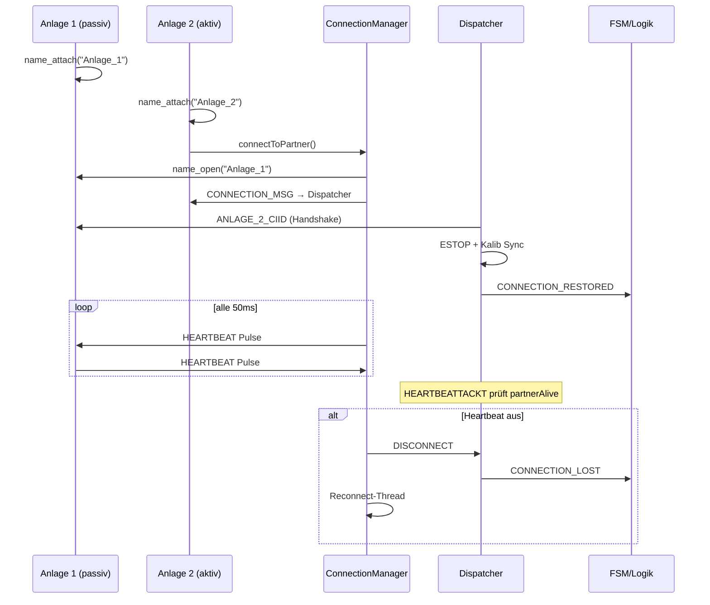

# Connection-Konzept (Anlage 1 ↔ Anlage 2)

SoSe2026 Team 3.3 — QNX-Netzwerkkommunikation zwischen VORN (Anlage 1) und HINTEN (Anlage 2).

---

## Grundidee

Zwei **eigene QNX-Prozesse** (Anlage 1 + Anlage 2) kommunizieren über **QNX Neutrino IPC** (qnet + Pulses). Es gibt **kein TCP/Socket** in der Logik — alles läuft über:

- `name_attach` / `name_open` (Partner finden)
- `MsgSendPulse` (Nachrichten schicken)
- `MsgReceive` (Dispatcher empfängt alles)

### Rollen

| Rolle    | Anlage              | Verhalten beim Start                          |
|----------|---------------------|-----------------------------------------------|
| Passiv   | Anlage 1 (VORN)     | Registriert sich als `"Anlage_1"`, wartet     |
| Aktiv    | Anlage 2 (HINTEN)   | Sucht sofort `"Anlage_1"` per `name_open`     |

---

## Phase 1 — Systemstart (`main`)

Reihenfolge in `src/esep-SoSe26-3-3.cpp`:

```
1. Dispatcher.init(pos)     → name_attach("Anlage_1" oder "Anlage_2")
2. ConnectionManager.init() → bekommt localCoid vom Dispatcher
3. HalSensors, Logik, Timer … verkabeln
4. Dispatcher-Thread starten (Reactor-Schleife)
5. Timer starten (Bandtakt 10 ms, Heartbeat-Watchdog 50 ms)
```

Der **Dispatcher** registriert sich global unter `/dev/name/global/Anlage_1` bzw. `Anlage_2`.

**Relevante Dateien:**

- `src/esep-SoSe26-3-3.cpp`
- `src/dispatcher/dispatcher.cpp` — `Dispatcher::init()`
- `src/shared/ipc_definitions.hpp` — Pulse-Codes

---

## Phase 2 — Partnersuche (`ConnectionManager`)

**Anlage 2** startet sofort die Suche (`ConnectionManager::init()` → `connectToPartner()`).

**Anlage 1** wartet passiv — sie wird gefunden, wenn A2 `name_open` ausführt.

### Connect-Thread (`connectionTask`)

1. Prüft alle **50 ms**: existiert `/dev/name/global/Anlage_1` (bzw. `Anlage_2`)?
2. Ruft `name_open()` auf → bekommt **Partner-COID**
3. Setzt `m_isConnected = true`
4. Schickt **internen Pulse** an eigenen Dispatcher: `CONNECTION_MSG` + Partner-COID
5. Startet **Heartbeat-Sender-Thread**
6. Thread beendet sich (Suche fertig)

**Relevante Dateien:**

- `src/connectionManager/ConnectionManager.cpp`
- `src/connectionManager/i_Connection.hpp`

---

## Phase 3 — Verbindung steht (Handshake)

Dispatcher empfängt `CONNECTION_MSG` und führt aus:

1. Speichert `m_partnerCoid`
2. **Anlage 2** sendet `ANLAGE_2_CIID` an Partner (Initial-Handshake)
3. **E-Stop-Status** beider Anlagen synchronisieren
4. **Kalibrierungsstatus** beider Anlagen synchronisieren
5. Erst danach: `CONNECTION_RESTORED` an die FSM

> Die FSM bekommt **nicht sofort** `CONNECTION_RESTORED`. Erst wenn der E-Stop-Status synchron ist, ruft `finishConnectionRestoreIfPending()` das Event aus.

**Relevante Dateien:**

- `src/dispatcher/dispatcher.cpp` — `handleConnectionPulse()`, `finishConnectionRestoreIfPending()`

---

## Phase 4 — Heartbeat (Lebenszeichen)

Zwei getrennte Mechanismen:

### A) Senden (ConnectionManager-Thread)

- Eigener Thread sendet alle **50 ms** `HEARTBEAT`-Pulse an Partner-COID
- Läuft **nicht** im Dispatcher → qnet-Blockade friert die Logik nicht ein

### B) Empfangen + Prüfen (Dispatcher + Timer)

- Partner-`HEARTBEAT` kommt beim Dispatcher an → `partnerAlive()` setzt Flag
- QNX-Timer feuert alle **50 ms** `HEARTBEATTACKT` → `heartbeatTackt()` prüft:

```
Grace-Phase (6 Ticks nach Connect): alles OK
Danach pro Tick:
  Partner-Heartbeat da?         → OK
  2× hintereinander fehlend?    → DISCONNECT → CONNECTION_LOST
```

**Konstanten** (`ConnectionManager.hpp`):

| Konstante                 | Wert | Bedeutung                              |
|---------------------------|------|----------------------------------------|
| `kConnectGraceTicks`      | 6    | Schonfrist direkt nach Verbindungsaufbau |
| `kHeartbeatSendIntervalMs`| 50   | Sendeintervall Heartbeat               |
| `kMaxMissedHeartbeats`      | 2    | Trennung nach 2 verpassten Ticks (~100 ms) |

**Relevante Dateien:**

- `src/connectionManager/ConnectionManager.cpp` — `heartbeatSenderTask()`, `heartbeatTackt()`
- `src/timer/timer.cpp` — QNX-Timer für `HEARTBEATTACKT`
- `src/dispatcher/dispatcher.cpp` — `processHeartbeatTackt()`

---

## Phase 5 — Normaler Betrieb (Daten über die Verbindung)

**ConnectionManager sendet selbst keine Anwendungsdaten** — nur Heartbeats und Verbindungslogik.

Der **Dispatcher** ist der **Postbote** für alles andere:

| Pulse-Code      | Inhalt                    | Beispiel                    |
|-----------------|---------------------------|-----------------------------|
| `HEARTBEAT`     | Lebenszeichen             | ConnectionManager           |
| `PARTNER_MSG`   | Taster, Status, Handover  | RESET, START, ESTOP         |
| `WP_INFO`       | Werkstück-ID + Typ        | A1 → A2 Übergabe            |
| `UPDATE_LIST`   | Rezeptur-Sync             | A2 → A1                     |
| `PARTNER_ESTOP` | Not-Halt-Status           | beide Richtungen            |

Empfang beim Partner → Dispatcher → `logik::Event` → FSM / WorkpieceManager.

**Relevante Dateien:**

- `src/shared/ipc_definitions.hpp` — alle Pulse-Codes
- `src/dispatcher/dispatcher.cpp` — Senden/Empfangen

---

## Phase 6 — Verbindungsverlust

### Auslöser

- 2× kein Partner-Heartbeat (~100 ms)
- `MsgSendPulse` schlägt fehl (qnet tot)
- Partner sendet `DISCONNECT`

### Ablauf

```
ConnectionManager.notifyLocalDisconnect()
  → DISCONNECT-Pulse an eigenen Dispatcher
    → handleLocalConnectionLost()
      → CONNECTION_LOST an FSM
      → acknowledgeConnectionLost()
        → RECONNECT_MSG (async)
          → performReconnect() → neuer Connect-Thread
```

### FSM-Reaktion (Level 0)

- `ActiveRegionState` → `ConnectionLostState`
- `EStopState` → `ConnectionLostAndEStopState`
- L1-Zustand wird in `L1StateRegistry` gespeichert (Deep History)
- Service-Kalibrierung: Phase in `ServiceCalibRegistry` gespeichert

Motor stoppt, Band sicher.

**Relevante Dateien:**

- `src/logik/fsm/level0/ConnectionLostState.cpp`
- `src/logik/fsm/level0/L0RestoreRegistry.cpp`
- `src/logik/fsm/level1/L1StateRegistry.cpp`
- `src/logik/fsm/level1/service/ServiceCalibRegistry.cpp`

---

## Phase 7 — Wiederherstellung

1. Connect-Thread findet Partner erneut
2. `CONNECTION_MSG` → ESTOP/Kalib-Sync
3. `CONNECTION_RESTORED` → FSM stellt gespeicherten Zustand wieder her
4. Heartbeat läuft wieder

---

## Connect-Thread nach `CONNECTION_LOST`

### Neuer Thread — kein Reaktivieren

Nach Verbindungsverlust wird **immer ein neuer** `std::thread` gestartet. Der alte Connect-Thread wird **nicht** wieder aktiviert.

```
Heartbeat aus / Send-Fehler
  → notifyLocalDisconnect()  → DISCONNECT-Pulse
    → Dispatcher: CONNECTION_LOST an FSM
    → acknowledgeConnectionLost()
        → scheduleReconnectAsync()  → RECONNECT_MSG-Pulse
          → performReconnect()
            → scheduleReconnect()
              → ConnectDetach(partnerCoid)
              → join(m_connectThread)        ← alter Thread aufräumen
              → connectToPartner()
                → std::thread(connectionTask) ← NEUER Thread
```

**Code:** `ConnectionManager.cpp` — `scheduleReconnect()`, `connectToPartner()`

### Lebenszyklus des Connect-Threads

| Phase | Was passiert |
|-------|----------------|
| **Erster Connect (A2 Start)** | Neuer Thread, sucht alle 50 ms per `name_open` |
| **Partner gefunden** | Thread beendet sich (`break` in `connectionTask`) |
| **Verbindung OK** | Connect-Thread ist **beendet**, `m_connectThread` ist noch `joinable` |
| **CONNECTION_LOST** | `join()` auf beendetem Thread, dann **neuer** `std::thread` |
| **Wieder verbunden** | Connect-Thread wieder beendet; Heartbeat-Thread läuft separat |

> Der Connect-Thread ist **kurzlebig** (nur für die Partnersuche). Der Heartbeat-Thread ist ein **eigener**, dauerhafter Thread während der Verbindung.

### Wer sucht nach Reconnect?

| Anlage | Erststart | Nach `CONNECTION_LOST` |
|--------|-----------|-------------------------|
| **A2 (aktiv)** | Connect-Thread sucht `Anlage_1` | Reconnect-Thread sucht `Anlage_1` wieder |
| **A1 (passiv)** | Wartet nur | Kann auch suchen, wenn A2 `ANLAGE_2_CIID` sendet und A1 noch nicht connected ist |

**Code:** `dispatcher.cpp` — bei `ANLAGE_2_CIID` ruft A1 `connectToPartner()` auf, falls noch nicht verbunden.

---

## GNS / Anlagenname (`name_attach`)

### Einmal registrieren — nicht bei jedem Reconnect

| Frage | Antwort im Code |
|-------|-----------------|
| Wann `name_attach`? | **Einmal** bei `Dispatcher::init()` beim Programmstart |
| Nochmal bei Reconnect? | **Nein** — der Name bleibt im GNS registriert |
| `name_detach` im Projekt? | **Nein** — nirgends aufgerufen |
| Timeout / Auto-Löschung im Code? | **Nein** — kein Timer, der den Namen entfernt |

```cpp
// dispatcher.cpp — nur beim Start
m_attachHandle = name_attach(NULL, myName.c_str(), NAME_FLAG_ATTACH_GLOBAL);
// myName = "Anlage_1" oder "Anlage_2"
```

Der Eintrag liegt unter `/dev/name/global/Anlage_1` bzw. `Anlage_2` und bleibt, **solange der Prozess läuft**.

### Unterschied `name_attach` vs. `name_open`

| Aufruf | Rolle | Wann |
|--------|-------|------|
| **`name_attach`** | „Ich bin unter diesem Namen erreichbar“ (Server) | Einmal beim Start |
| **`name_open`** | „Ich suche den Partner unter diesem Namen“ (Client) | Bei jeder Partnersuche / Reconnect |

Bei Reconnect wird nur **`name_open`** erneut aufgerufen — **`name_attach` nicht**.

### Verhalten bei Prozess-Ende / Absturz

| Situation | GNS-Name |
|-----------|----------|
| **Normaler Lauf** | Name bleibt bis Prozess endet |
| **Sauberes Beenden** | Destruktor: `ChannelDestroy`, aber kein explizites `name_detach` — QNX räumt mit auf |
| **Absturz / Kill** | Eintrag kann kurz „hängen“ — regelt **QNX/GNS**, nicht der Anwendungscode |
| **Neustart der Anlage** | Neuer Prozess → neues `name_attach` → Name wieder verfügbar |

### Gesamtbild Start → Verlust → Reconnect

```
Programmstart
  A1: name_attach("Anlage_1")  ── bleibt dauerhaft
  A2: name_attach("Anlage_2")  ── bleibt dauerhaft
  A2: Connect-Thread → name_open("Anlage_1") → verbunden

CONNECTION_LOST
  ConnectDetach(partner)       ← alte qnet-Verbindung weg
  name_attach unverändert      ← Name bleibt im GNS
  NEUER Connect-Thread         ← name_open erneut, alle 50 ms

Wieder verbunden
  Neues Partner-COID, neuer Heartbeat-Thread
  GNS-Namen unverändert
```

---

## Sequenzdiagramm



---

## Verantwortlichkeiten

| Komponente            | Aufgabe                                              | Macht **nicht**                    |
|-----------------------|------------------------------------------------------|------------------------------------|
| **ConnectionManager** | Suchen, Heartbeat senden, Watchdog, Reconnect        | Keine WP-Daten, keine FSM-Logik    |
| **Dispatcher**        | Alle Pulse empfangen/weiterleiten, Partner senden    | Keine Verbindungslogik             |
| **Timer (QNX)**       | `HEARTBEATTACKT` + `BELT_TICK` feuern              | Kein eigener Thread                |
| **FSM**               | `CONNECTION_LOST` / `RESTORED` reagieren             | Kein Netzwerk                      |

---

## Threads im Connection-Kontext

| Thread              | Komponente          | Dauerhaft?                          |
|---------------------|---------------------|-------------------------------------|
| Dispatcher-Reaktor  | `Dispatcher::run()` | Ja                                  |
| Connect-Suche       | `m_connectThread`   | Nein (endet nach erfolgreichem Connect) |
| Heartbeat-Sender    | `m_heartbeatThread` | Ja (solange verbunden)              |

Der QNX-Timer für `HEARTBEATTACKT` ist **kein Thread** — er schickt Pulses an den Dispatcher-Channel.

---

## Pulse-Codes (Auszug)

Definiert in `src/shared/ipc_definitions.hpp`:

| Code               | Bereich        | Bedeutung                              |
|--------------------|----------------|----------------------------------------|
| `CONNECTION_MSG`   | Lokal          | Partner gefunden (intern)              |
| `DISCONNECT`       | Lokal          | Verbindung verloren (intern)           |
| `RECONNECT_MSG`    | Lokal          | Reconnect im Hintergrund starten       |
| `HEARTBEATTACKT`   | Timer          | Watchdog-Tick (50 ms)                  |
| `HEARTBEAT`        | Netzwerk       | Lebenszeichen an Partner               |
| `ANLAGE_2_CIID`    | Netzwerk       | A2-Handshake nach Connect              |
| `PARTNER_MSG`      | Netzwerk       | Generische Partner-Nachricht           |
| `WP_INFO`          | Netzwerk       | Werkstück-Übergabe                     |
| `PARTNER_ESTOP`    | Netzwerk       | Partner-E-Stop-Status                  |

---

## Merksätze

1. **QNX Pulses** = einzige Kommunikationsform (kein HTTP, kein MQTT)
2. **A2 sucht, A1 wartet** — asymmetrischer Verbindungsaufbau
3. **Zwei Heartbeat-Ebenen:** Sender-Thread (50 ms) + Watchdog-Timer (50 ms)
4. **Dispatcher blockiert nie** auf qnet — deshalb eigener Heartbeat-Thread
5. **Connection ≠ Anwendung** — ConnectionManager nur Link; Dispatcher transportiert WP/Events
6. **Reconnect automatisch** — nach Verlust startet Partnersuche von neuem
7. **Connect-Thread neu** — nach `CONNECTION_LOST` wird ein frischer Thread gestartet, der alte nicht reaktiviert
8. **GNS-Name persistent** — `name_attach` einmal beim Start; Reconnect nutzt nur `name_open`

---

## Dateiübersicht

```
src/
├── esep-SoSe26-3-3.cpp              # Composition Root, Thread-Start
├── connectionManager/
│   ├── ConnectionManager.cpp/hpp    # Suche, Heartbeat, Watchdog, Reconnect
│   └── i_Connection.hpp             # Interface für Dispatcher
├── dispatcher/
│   ├── dispatcher.cpp/hpp           # Reactor, Pulse-Routing, Partner-Nachrichten
│   └── i_Dispatcher.hpp
├── timer/
│   └── timer.cpp                    # QNX-Timer (BELT_TICK, HEARTBEATTACKT)
└── shared/
    └── ipc_definitions.hpp          # Pulse-Codes, Payload-Encoding
```
