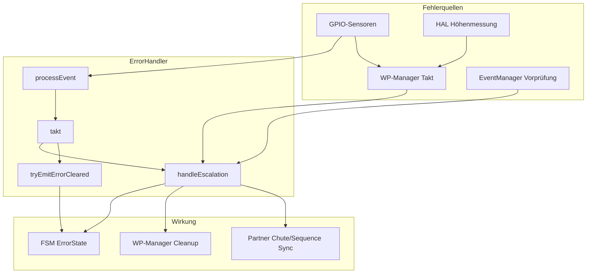

# Error-Handler-Konzept (Fehler, Warnungen, Recovery)

SoSe2026 Team 3.3 — zentrales Fehlermanagement und Watchdog-Überwachung.

Verwandte Dokumente: [WP_TRACKING_KONZEPT.md](WP_TRACKING_KONZEPT.md), [UEBERGABE_KONZEPT.md](UEBERGABE_KONZEPT.md), [CONNECTION_KONZEPT.md](CONNECTION_KONZEPT.md)

---

## Grundidee

Der **ErrorHandler** ist die zentrale Schaltstelle für:

1. **Harte Fehler (ErrorType)** → Band stoppt, FSM wechselt in `ErrorState`, rote Ampel
2. **Weiche Warnungen (WarningID)** → Band läuft weiter, gelbe Ampel, Sortierstrategie ändert sich
3. **Watchdogs** → zeitliche Überwachung von Einlauf-Stau und Rutsche-voll
4. **Recovery** → Erkennung, wann die physische Fehlerursache behoben ist (`ERROR_CLEARED`)

```
Sensor / Timeout / Logik-Regel
         │
         ▼
  WorkpieceManager ──┐
  EventManager ──────┼──► handleEscalation(ErrorType)
  ErrorHandler.takt()┘              │
                                    ▼
                         setErrorActive(true)
                         WP bereinigen / Handover abbrechen
                         Event::ERROR → FSM → ErrorState
                                    │
                                    ▼
              Bediener: Ursache beheben → ERROR_CLEARED
              Bediener: RESET → START → ActiveRegion
```

**Kernprinzip:** Fehler werden **nicht** direkt in der FSM erkannt, sondern von Subsystemen gemeldet. Der ErrorHandler führt die **einheitliche Eskalation** aus und trackt die **aktive Fehlerursache** für die Recovery.

---

## Architektur & Einbindung

| Komponente | Rolle |
|------------|-------|
| `ErrorHandler` | Watchdogs, Eskalation, Chute-Warning, Recovery-Tracking |
| `EventManager` | Routing, frühe EARLY_ENTRY/UNEXPECTED-Prüfung, `errorActive`-Flag |
| `WorkpieceManager` | Transit-Timeouts (WP_LOST/STUCK), Sensor-Plausibilität, BOTH_CHUTES_FULL |
| `ErrorState` (FSM L0) | Bediener-Workflow: quittieren, START nach behobener Ursache |
| `RunningState` (FSM L1) | WARNING / WARNING_CLEARED, Chute-Reconcile beim Betriebsstart |

### Aufrufkette (10-ms-Takt)

```
Timer (10 ms)
  └─► Logik::takt()
        ├─► EventManager::handleTakt()   → WorkpieceManager::takt() (Transit-Timeouts)
        └─► ErrorHandler::takt()         → Entry-Watchdog, Chute-Watchdog, Recovery-Polling
```

### Event-Routing (`EventManager::handleEvent`)

```
Phase 1: Subsysteme
  routeToErrorHandler(e)     → processEvent() (Watchdog-Timer start/stop)
  routeToWorkpieceManager(e) → handleSensorSignal() (Plausibilität, Eskalation)

Phase 2: updateContextFlags(e)   → heightBlocked, endBlocked, errorActive, …

Phase 3: checkActiveErrorClearedByEvent(e)  (nur bei errorActive + Sensor-Event)

Phase 4: routeToFsm(e)           → ERROR / ERROR_CLEARED / WARNING / …
```

> Im **ErrorState** werden END/CHUTE-Sensoren weiter verarbeitet (Rutsche entleeren). WP-Tracking ist eingefroren (`errorActive`).

**Relevante Dateien:**

- `src/logik/errorHandler/errorHandler.hpp` / `.cpp`
- `src/logik/errorHandler/errorTypes.hpp`
- `src/logik/eventManager/eventManager.cpp`
- `src/logik/workpieceManager/WorkpieceManager.cpp`
- `src/logik/fsm/level0/ErrorState.cpp`

---

## Fehler vs. Warnung

| Kategorie | Enum | Band | Ampel | FSM |
|-----------|------|------|-------|-----|
| **Harter Fehler** | `ErrorType::*` | Stop | Rot (blinkend/dauerhaft) | `ErrorState` |
| **Warnung** | `WarningID::*` (indirekt) | Läuft | Gelb | `RunningState` Warning-Substate |

### ErrorType (harter Stopp)

| Typ | Bedeutung | Typische Quelle |
|-----|-----------|-----------------|
| `WP_LOST` | Werkstück im Transit nicht rechtzeitig angekommen | `WorkpieceManager::takt()` — Transit-Timeout |
| `STUCK` | Werkstück blockiert Sensor zu lange | WP-Manager (HS/Weiche) oder Entry-Watchdog |
| `UNEXPECTED_EVENT` | Sensor ohne passendes WP im Schieberegister | WP-Manager, EventManager (leeres Band) |
| `EARLY_ENTRY` | Zweites WP am Einlauf, bevor vorderes den HS erreicht hat | EventManager, WP-Manager |
| `HEIGHT_ERROR` | Falsche Geometrie / Höhenmessung im Lichttunnel | HAL → `HEIGHT_ERROR` |
| `BOTH_CHUTES_FULL` | Aussortierung unmöglich — beide Rutschen voll | WP-Manager bei Sortierentscheidung |

### WarningID (weicher Alarm — kein Bandstopp)

| Typ | Bedeutung | Quelle |
|-----|-----------|--------|
| `LOCAL_CHUTE_FULL` | Eigene Rutsche voll | Chute-Watchdog / `ensureChuteWarningRaised()` |
| `PARTNER_CHUTE_FULL` | Partner-Rutsche voll (Netzwerk) | `Logik::setPartnerChuteStatus(true)` |
| `NONE` | Normalbetrieb | `WARNING_CLEARED` |

---

## Zentrale Eskalation: `handleEscalation()`

Jeder Fehler läuft durch dieselbe Pipeline:

```
1. Duplikat-Schutz (HEIGHT_ERROR, UNEXPECTED gleicher Trigger)
2. EventManager::setErrorActive(true)     → Schieberegister einfrieren
3. Handover abbrechen (STUCK/WP_LOST an Einlauf/HS während Übergabe)
4. Diagnose-Ausgabe (Konsole) + WP bereinigen (je nach Typ)
5. Anlage 2: notifyPartnerSequenceSync() bei WP_LOST/STUCK/HEIGHT_ERROR
6. Aktiven Fehler merken (Typ, Trigger, Zone)
7. EventManager::handleEvent(ERROR)      → FSM → ErrorState
8. WP_LOST: sofort tryEmitErrorCleared()   → GoneUnacknowledged wenn Ursache weg
```

### Automatische WP-Maßnahmen pro Typ

| ErrorType | Schieberegister | Physische Aktion nötig? |
|-----------|-----------------|-------------------------|
| `WP_LOST` | Betroffenes WP löschen | Optional prüfen (vom Band gefallen?) |
| `STUCK` | Blockiertes WP löschen | Ja — Sensorbereich freimachen |
| `HEIGHT_ERROR` | Fehlerhaftes WP löschen | Ja — Teil aus Lichttunnel entfernen |
| `BOTH_CHUTES_FULL` | WP an Weiche + TRANSIT_TO_CHUTE löschen | Ja — beide Rutschen entleeren |
| `UNEXPECTED_EVENT` | Kein automatisches Löschen | Ja — fremdes Objekt entfernen |
| `EARLY_ENTRY` | Kein automatisches Löschen | Ja — zusätzliches WP vom Einlauf nehmen |

---

## Fehlerquellen im Detail

### 1. Transit-Timeouts → `WP_LOST`

Der **WorkpieceManager** zählt pro WP in jeder Zone Takte (10 ms). Überschreitung von `targetLimit + kTimeoutToleranceTicks` (Toleranz = **5 Takte / 50 ms**):

| Zone | Erwartetes nächstes Event |
|------|---------------------------|
| `AT_ENTRY` | `ENTRY_CLEARED` (nach `ENTRY_BLOCKED` gesehen) |
| `TRANSIT_TO_HEIGHT` | `HEIGHT_BLOCKED` |
| `TRANSIT_TO_EJECTOR` | `EJECTOR_BLOCKED` |
| `TRANSIT_TO_CHUTE` | `CHUTE_BLOCKED` |
| `TRANSIT_TO_END` | `END_BLOCKED` |

Zusätzlich: **Übergabe-Timeout auf A2** — `ENTRY_BLOCKED` kommt nach Netzwerk-WP-Info nicht innerhalb von **300 Takten (3 s)** → `WP_LOST` am Einlauf.

### 2. Belegungs-Timeouts → `STUCK`

WP bleibt zu lange **an** einem Sensor (Motor läuft):

| Zone | Limit-Basis | Trigger-Event |
|------|-------------|---------------|
| `AT_HEIGHT_SENSOR` | Kalibrierung HeightB→HeightC | `HEIGHT_BLOCKED` |
| `AT_EJECTOR` | Kalibrierung EjectorB→EjectorC + Metall-Wartezeit | `EJECTOR_BLOCKED` |

### 3. Einlauf-Watchdog → `STUCK` (ErrorHandler)

Unabhängig vom WP-Transit-Timer: Wenn **ENTRY_BLOCKED** länger als **1000 ms** anhält:

```
Bedingungen für aktiven Watchdog:
  - Erwartetes WP am Einlauf (A1: entryFrei + kein endBlocked)
  - A2: WP an AT_ENTRY oder pending Network-WP
  - Motor AN, kein Error, kein endBlocked
  - WP nicht „hinter führendem WP in Warteschlange"

Sonderfall: LS ist frei, aber Geister-WP im Register
  → discardGhostEntryWorkpieceIfSensorClear(), kein STUCK
```

Watchdog pausiert, wenn Motor aus oder Einlauf regulär wartet.

### 4. Sensor-Plausibilität → `UNEXPECTED_EVENT`

Typische Fälle im **WorkpieceManager**:

- Sensor-Event, aber kein WP in der erwarteten Zone
- Sensor-Event „zu spät“ (WP schon weitergezogen)
- A2: `ENTRY_BLOCKED` ohne Netzwerk-Übergabe / vor `MOTOR_RUN`
- A2: `READY_TO_RECEIVE_WP` am Bandende ohne Handover-Kontext
- **EventManager:** Band leer (`!hasActiveWorkpieces()`), aber irgendein Sensor außer erlaubtem Einlauf/Rutsche

Erlaubt bei leerem Band (A1): Einlauf wenn Q1 frei; Rutsche.  
Erlaubt bei leerem Band (A2): Einlauf nur während erwarteter Übergabe; Rutsche.

### 5. Einlauf zu früh → `EARLY_ENTRY`

**A1:** `ENTRY_BLOCKED` obwohl Q1 nicht frei (`!entryFrei`) — vorderes WP hat HS noch nicht erreicht.  
**A2:** `ENTRY_BLOCKED` obwohl kein Netzwerk-WP erwartet und vorderes WP den HS noch nicht erreicht hat.

Prüfung **vor** WP-Routing im EventManager (frühe Abwehr).

### 6. Höhenfehler → `HEIGHT_ERROR`

HAL meldet `HEIGHT_ERROR` (falsche Höhe / verkehrt herum). WP-Manager findet WP an `AT_HEIGHT_SENSOR` oder `TRANSIT_TO_HEIGHT` und eskaliert.

**Recovery-Sonderfall:** Nach manuellem Entfernen kann der HS-Tunnel frei sein, bevor `HEIGHT_CLEARED` als GPIO-Flanke kommt. Dann liefert die ADC-Messung (`workpieceTypeFromHS`) im ErrorState ein synthetisches `HEIGHT_CLEARED`.

### 7. Beide Rutschen voll → `BOTH_CHUTES_FULL`

Bei Sortierentscheidung „aussortieren“, aber:

- **A2:** lokale Rutsche voll → sofort Fehler
- **A1:** Partner-Rutsche auch voll → Fehler (sonst: WP an Partner weiterleiten)

Zusätzlich werden WP an Weiche und auf `TRANSIT_TO_CHUTE` aus dem Register entfernt; Metall-Warte-Timer wird zurückgesetzt.

---

## Rutsche-Watchdog & Warnungen

```
CHUTE_BLOCKED (Flanke) oder LS dauerhaft blockiert
  └─► Timer starten (1000 ms)

Nach 1 s blockiert:
  └─► raiseChuteFullWarning()
        ├─► setChuteFull(true)
        ├─► sendeChuteStats(true) an Partner
        └─► Event::WARNING → RunningState (gelb)

CHUTE_CLEARED / LS frei:
  └─► clearChuteWarningState()
        ├─► setChuteFull(false)
        ├─► sendeChuteStats(false)
        └─► Event::WARNING_CLEARED
```

**Level-Check beim Betriebsstart** (`reconcileChuteWarningOnOperationalEntry`): Auch ohne frische Flanke wird die Rutsche per GPIO-Level geprüft — wichtig, wenn `CHUTE_BLOCKED` schon vor `Running` aktiv war.

**Partner-Rutsche:** Netzwerk-Pulse → `Logik::setPartnerChuteStatus()` → `WARNING` / `WARNING_CLEARED` (nur wenn lokal nicht im Error/Service).

---

## ErrorState — Bediener-Workflow

Der ErrorState (FSM Ebene 0) hat **drei Substates** mit unterschiedlicher LED-Signalisierung:

```
                    ERROR eintritt
                          │
                          ▼
              ┌───────────────────────┐
              │ PendingUnacknowledged │  Rot schnell blinkend
              │ (Fehler aktiv)        │  RESET blinkt schnell
              └───────────┬───────────┘
                          │ RESET gedrückt
                          ▼
              ┌───────────────────────┐
              │ PendingAcknowledged   │  Rot dauerhaft
              │ (quittiert)           │  RESET an
              └───────────┬───────────┘
                          │
         ┌────────────────┼────────────────┐
         │ ERROR_CLEARED  │                │ neuer ERROR
         ▼                │ START (nur wenn│
┌─────────────────┐       │ Ursache weg)   ▼
│ GoneUnacknowledged│◄────┘         zurück zu PendingUnack
│ (Fehler behoben)  │
│ Rot langsam blink │
└────────┬──────────┘
         │ RESET
         ▼
   PendingAcknowledged → START → ActiveRegion (H*)
```

| Substate | Rot | RESET | START | Bedeutung |
|----------|-----|-------|-------|-----------|
| PendingUnacknowledged | Blink schnell | Blink schnell | Aus | Fehler + Ursache aktiv |
| PendingAcknowledged | Dauerhaft an | Dauerhaft an | Blink langsam * | Quittiert, warte auf Ursachenbehebung |
| GoneUnacknowledged | Blink langsam | Blink schnell | Aus | Ursache weg, RESET zum Quittieren |

\* START blinkt langsam erst nach `ERROR_CLEARED` (`onErrorCauseCleared`).

**Verlassen des ErrorState:** `START` nur wenn `canLeaveErrorWithStart()` — d.h. `ErrorHandler::isErrorCauseCleared()` bestätigt, dass kein Sensor mehr blockiert (Ausnahme: `WP_LOST` hat keine physische Bedingung).

Nach erfolgreichem Exit:

- `setErrorActive(false)`
- `resetActiveErrorTracking()`
- A2: `recoverPartnerHandoverAfterError()`
- Chute-Warning reconcile
- Übergang zu `ActiveRegionState` (History-Restore)

---

## Recovery: `ERROR_CLEARED`

Der ErrorHandler prüft kontinuierlich, ob die **physische Fehlerursache** behoben ist:

### Auslöser

1. **Sensor-Event** nach `updateContextFlags` → `checkActiveErrorClearedByEvent(e)`
2. **Periodisch** in `takt()` → `tryEmitErrorCleared("periodische Pruefung")`
3. **Sofort** nach `WP_LOST`-Eskalation (WP bereits gelöscht)

### Clearing-Regeln (`doesEventClearActiveError`)

| ErrorType | Clearing-Event |
|-----------|----------------|
| `UNEXPECTED_EVENT` | Passendes CLEARED zum Trigger-Sensor (z.B. `ENTRY_CLEARED` bei `ENTRY_BLOCKED`) |
| `EARLY_ENTRY` | `ENTRY_CLEARED` |
| `HEIGHT_ERROR` | `HEIGHT_CLEARED` |
| `STUCK` @ Einlauf | `ENTRY_CLEARED` |
| `STUCK` @ HS | `HEIGHT_CLEARED` |
| `STUCK` @ Weiche | `EJECTOR_CLEARED` |
| `BOTH_CHUTES_FULL` | `CHUTE_CLEARED` |
| `WP_LOST` | Keine physische Bedingung — sofort cleared |

### Re-Eskalation

Wenn `errorActive`, aber Sensor **noch blockiert** und kein aktives Tracking → erneutes `ERROR` (Rot schnell). Verhindert „stilles“ Weiterlaufen mit blockiertem Sensor.

---

## Service-Modus & Connection Lost

| Situation | ErrorHandler-Verhalten |
|-----------|------------------------|
| **Service-Modus** | `takt()` und Entry-Watchdog deaktiviert; Chute-Watchdog pausiert |
| **Connection Lost** | ErrorState kann zu `ConnectionLostState` wechseln; Substate wird für Restore gespeichert (`L0RestoreRegistry`) |
| **Connection Restored** | ErrorState mit gespeichertem Substate wiederherstellen (Pending/Gone/PendingAck) |

---

## Konstanten & Schwellwerte

| Konstante | Wert | Bedeutung |
|-----------|------|-----------|
| `TIMEOUT_THRESHOLD` | 1000 ms | Entry-Stau + Chute-Watchdog |
| `kTimeoutToleranceTicks` | 5 (50 ms) | Zusatz-Toleranz auf kalibrierte Transit-Limits |
| `kHandoverEntryTimeoutTicks` | 300 (3 s) | A2: Warten auf `ENTRY_BLOCKED` nach Netzwerk-WP |

---

## Datenfluss — Gesamtübersicht



---

## Kurz-Referenz: Wer ruft was?

| Aufrufer | Methode | Wann |
|----------|---------|------|
| `EventManager` | `processEvent()` | ENTRY/END/CHUTE/HEIGHT-Events |
| `EventManager` | `handleEscalation(EARLY_ENTRY, UNEXPECTED)` | Vor WP-Routing |
| `WorkpieceManager::takt()` | `handleEscalation(WP_LOST, STUCK)` | Transit-/Belegungs-Timeout |
| `WorkpieceManager` | `handleEscalation(UNEXPECTED, HEIGHT, BOTH_CHUTES)` | Sensor-Logik, Sortierung |
| `ErrorHandler::takt()` | `handleEscalation(STUCK)` | Entry-Watchdog 1 s |
| `ErrorHandler::takt()` | `raiseChuteFullWarning()` | Chute-Watchdog 1 s |
| `ErrorHandler` | `tryEmitErrorCleared()` | Recovery erkannt |
| `RunningState::entry()` | `reconcileChuteWarningOnOperationalEntry()` | Betriebsstart |

---

## Design-Entscheidungen

1. **Eine Eskalationsstelle** — alle Fehler laufen durch `handleEscalation()`, einheitliche Diagnose und WP-Bereinigung.
2. **Fehler ≠ Warnung** — volle Rutsche stoppt nicht sofort; Sortierstrategie weicht aus, bis beide voll sind (`BOTH_CHUTES_FULL`).
3. **Schieberegister einfrieren** — bei `errorActive` kein WP-Tracking mehr; verhindert Kaskadenfehler.
4. **GoneUnacknowledged** — Operator sieht: Fehler behoben (Rot langsam), muss noch RESET quittieren.
5. **Zwei Watchdog-Ebenen** — kalibrierte WP-Takte (fein) + 1-s-Hardware-Watchdog (Einlauf/Rutsche, grob).
6. **A2-Sync** — nach kritischen Fehlern wird das Rezept/Sequence-Signal an A1 zurückgesetzt (`notifyPartnerSequenceSync`).
