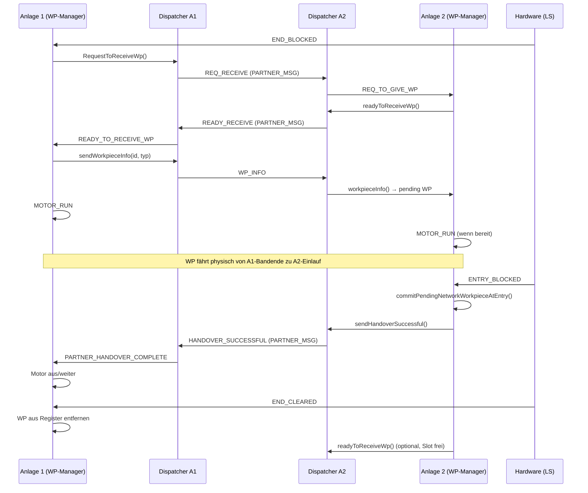

# Übergabe-Konzept (Anlage 1 → Anlage 2)

SoSe2026 Team 3.3 — Netzwerk-Werkstückübergabe am Bandende zwischen VORN (Anlage 1) und HINTEN (Anlage 2).

---

## Grundidee

Ein Werkstück (WP), das auf **Anlage 1** das **Bandende** erreicht, soll physisch auf **Anlage 2** am **Einlauf** ankommen. Beide Anlagen koordinieren das über **QNX-Pulses** — die Logik läuft im `WorkpieceManager` (Schieberegister / Digitaler Zwilling).

**Wichtig:** Die Übergabe ist **kein Datei- oder Socket-Transfer**, sondern:

1. **Anfrage / Freigabe** (dürfen wir übergeben?)
2. **Metadaten** (WP-ID + Typ per `WP_INFO`)
3. **Physische Fahrt** (Motor A1 läuft, Motor A2 startet bei Bedarf)
4. **Bestätigung** (Einlauf-LS auf A2 → Erfolg an A1)

```
Anlage 1 (Bandende)                    Anlage 2 (Einlauf)
      │                                        │
      │  REQ_TO_GIVE ────────────────────────►│
      │◄────────────── READY_TO_RECEIVE       │
      │  WP_INFO (id, typ) ──────────────────►│
      │  [Motor A1: Band läuft]               │  [Motor A2: ggf. MOTOR_RUN]
      │                                        │  ENTRY_BLOCKED (physisch)
      │◄──────────── HANDOVER_SUCCESSFUL      │
      │  END_CLEARED (WP verlässt A1)          │
```

**Voraussetzungen für normale Übergabe:**

- Partner **verbunden** (`CONNECTION_RESTORED`, kein `CONNECTION_LOST`)
- Beide Anlagen **kalibriert** (`isPartnerCalibrationReady()`)
- Beide im **Running-Modus** (kein Service, kein aktiver Fehler)
- Anlage 2: **Bandende frei** (`m_isAnlage2Ready`, kein WP an `AT_END`)

---

## Netzwerk-Nachrichten

Definiert in `src/shared/ipc_definitions.hpp`, transportiert über `Dispatcher` als QNX-Pulse.

| IPC (`NetworkMessage` / Code) | Logik-Event | Richtung | Bedeutung |
|-------------------------------|-------------|----------|-----------|
| `REQ_RECEIVE` via `PARTNER_MSG` | `REQ_TO_GIVE_WP` | A1 → A2 | „Darf ich ein WP übergeben?“ |
| `READY_RECEIVE` via `PARTNER_MSG` | `READY_TO_RECEIVE_WP` | A2 → A1 | „Ja, ich bin bereit.“ |
| `WP_INFO` | — (→ `workpieceInfo()`) | A1 → A2 | WP-ID (high 16 bit) + Typ (low 16 bit) |
| `HANDOVER_SUCCESSFUL` via `PARTNER_MSG` | `PARTNER_HANDOVER_COMPLETE` | A2 → A1 | WP physisch am Einlauf A2 |
| `HANDOVER_WP_LOST` via `PARTNER_MSG` | `PARTNER_HANDOVER_WP_LOST` | A2 → A1 | Übergabe fehlgeschlagen |
| `HANDOVER_PAUSE` via `PARTNER_MSG` | `PARTNER_HANDOVER_PAUSE` | A2 → A1 | A2-Bandende blockiert → A1 pausieren |
| `UPDATE_LIST` | — (→ `updateWpListe()`) | A2 → A1 | Rezeptur-Sync nach Fehler/WP-Austritt |

**Dispatcher-Methoden:** `RequestToReceiveWp()`, `readyToReceiveWp()`, `sendWorkpieceInfo()`, `sendHandoverSuccessful()`, `sendHandoverWpLost()`, `sendHandoverPause()`, `updateWpListe()`

**Routing:** `EventManager` leitet Partner-Events an `WorkpieceManager`-Handler weiter (`eventManager.cpp`).

---

## Phase 1 — WP erreicht Bandende (Anlage 1)

**Trigger:** `END_BLOCKED` — WP wechselt von `TRANSIT_TO_END` → `AT_END`.

```cpp
// WorkpieceManager.cpp — END_BLOCKED auf A1
m_awaitingHandoverReady = true;
m_context->getDispatcher()->RequestToReceiveWp();  // wenn Partner OK
```

| Bedingung | Verhalten |
|-----------|-----------|
| Partner verbunden + kalibriert | `REQ_TO_GIVE` senden |
| Partner nicht bereit | Warten, **keine** Anfrage (Rezept ggf. lokal fortsetzen) |
| Bereits `awaitingHandoverReady` | Retry-Logik (siehe Phase 6) |

**Anlage 2** bei eigenem `END_BLOCKED`: `setAnlage2Ready(false)` — Bandende belegt, keine Übergabe.

---

## Phase 2 — Anlage 2 prüft und antwortet

**Trigger:** `REQ_TO_GIVE_WP` → `onPartnerHandoverRequest()`.

Prüfungen in `canAcceptNetworkHandover()`:

- Max. **2 aktive WPs** auf A2 (inkl. pending)
- `m_isAnlage2Ready == true`
- Kein WP an Einlauf, kein `TRANSIT_TO_HEIGHT`, kein `TRANSIT_TO_END` / `AT_END`
- Kein Fehler, kein Service, keine ConnectionLost
- Bandende-LS nicht blockiert (`!endBlocked`)

| Ergebnis | Aktion |
|----------|--------|
| Alles OK | `READY_TO_RECEIVE` senden |
| Nicht bereit | Anfrage **ignorieren** (kein READY) |
| Max. Kapazität | Anfrage **ignorieren** |

A2 kann auch **proaktiv** `READY_TO_RECEIVE` senden, wenn das Bandende frei wird (`notifyPartnerHandoverSlotFree()` nach `END_CLEARED`).

---

## Phase 3 — Anlage 1 sendet WP-Info und startet Motor

**Trigger:** `READY_TO_RECEIVE_WP` → `onPartnerReadyToReceive()`.

1. WP muss an `AT_END` liegen
2. `sendWorkpieceInfo(id, type)` → Pulse `WP_INFO` an A2
3. `MOTOR_RUN` — Band auf A1 läuft für Übergabe
4. Flags setzen:
   - `m_handoverInfoSent = true`
   - `m_handoverMotorActive = true`
   - `m_awaitingHandoverReady = false`

> **Motor auf A1** bleibt aktiv, bis A2 `HANDOVER_SUCCESSFUL` meldet — `MOTOR_STOP` wird während `isHandoverMotorActive()` unterdrückt.

---

## Phase 4 — Anlage 2 übernimmt (Pending-Pattern)

**Trigger:** `WP_INFO` → `Logik::workpieceInfo()` → `storePendingNetworkWorkpiece()`.

Das WP existiert auf A2 **zuerst nur logisch** (noch nicht am Einlauf):

```cpp
m_pendingNetworkWpId = id;
m_pendingNetworkWpType = type;
m_hasPendingNetworkWp = true;
m_handoverReceiveActive = true;
```

| Bedingung auf A2 | Motor |
|------------------|-------|
| Bandende frei + `isAnlage2Ready` + kein WP an `AT_END` | `MOTOR_RUN` (Einlauf erwartet WP) |
| Bandende belegt / nicht bereit | Motor bleibt aus, Info **gespeichert** |

**Timeout:** Wenn nach `WP_INFO` innerhalb **300 Takten (3 s)** kein `ENTRY_BLOCKED` kommt → `WP_LOST` Fehler (`kHandoverEntryTimeoutTicks`).

Timer pausiert bei: Fehler, Service, ConnectionLost, `endBlocked`, `!isAnlage2Ready`.

---

## Phase 5 — Physische Ankunft am Einlauf (Anlage 2)

**Trigger:** `ENTRY_BLOCKED` + `m_hasPendingNetworkWp`.

```cpp
commitPendingNetworkWorkpieceAtEntry();
// → addNetworkWorkpiece() — WP in Schieberegister an AT_ENTRY
// → sendHandoverSuccessful() an A1
```

Danach:

- `m_handoverReceiveActive = false`
- `m_hasPendingNetworkWp = false`
- WP im normalen Fertigungsablauf auf A2

---

## Phase 6 — Abschluss auf Anlage 1

**Trigger:** `PARTNER_HANDOVER_COMPLETE` → `onPartnerHandoverComplete()`.

1. `m_handoverMotorActive = false`
2. Motor weiter oder stoppen (je nach weiteren WPs auf Band)
3. WP darf A1 physisch verlassen → **`END_CLEARED`**

**`END_CLEARED` auf A1** (nur wenn `m_handoverInfoSent` war):

- WP aus Schieberegister entfernen
- `m_handoverInfoSent = false`
- Rezept-Fortschritt (`forceType` bei korrektem WP)

> **`END_CLEARED` vor `HANDOVER_SUCCESSFUL`** → `UNEXPECTED_EVENT` (WP verlässt A1 zu früh).

---

## Sonderfälle

### Retry — A2 antwortet nicht (1 s)

Wenn A1 auf `READY_TO_RECEIVE` wartet (`m_awaitingHandoverReady`):

- Alle **100 Takte (1 s)** erneut `REQ_TO_GIVE` (`kHandoverRetryIntervalTicks`)
- Nur wenn WP noch an `AT_END`, Partner verbunden + kalibriert

### Pause — A2-Bandende wird während Übergabe belegt

Wenn auf A2 während laufender Übergabe ein WP `END_BLOCKED` am Bandende:

1. `sendHandoverPause()` an A1
2. A1: `MOTOR_STOP`, `m_handoverPausedByPartner = true`
3. WP bleibt physisch am Bandende A1

**Fortsetzen:** Wenn A2 wieder `READY_TO_RECEIVE` sendet und Übergabe pausiert war → A1 `MOTOR_RUN` erneut.

### Übergabe verloren

| Auslöser | Meldung | A1-Reaktion |
|----------|---------|-------------|
| Timeout 3 s ohne `ENTRY_BLOCKED` auf A2 | `WP_LOST` Fehler lokal | — |
| A2 lehnt WP-Info ab (max. 2 WPs) | `HANDOVER_WP_LOST` | Motor aus/weiter |
| A2 meldet explizit Fehler | `HANDOVER_WP_LOST` | Handover-State reset |

### Kapazität Anlage 2

- Max. **2 WPs** gleichzeitig (`kMaxActiveWorkpiecesAnlage2`)
- Pending-Netzwerk-WP zählt mit in die Kapazität
- Bei Überlauf: `sendHandoverWpLost()` sofort bei `storePendingNetworkWorkpiece()`

### Rezept-Sync (`UPDATE_LIST`)

Anlage 2 sendet erwarteten WP-Typ an Anlage 1 (`notifyPartnerSequenceSync()`), z. B. nach Fehlerende — damit das Rezept auf A1 wieder passt.

---

## Zustandsflags (Übersicht)

### Anlage 1

| Flag | Bedeutung |
|------|-----------|
| `m_awaitingHandoverReady` | WP an `AT_END`, wartet auf `READY_TO_RECEIVE` |
| `m_handoverInfoSent` | `WP_INFO` gesendet, `END_CLEARED` erst nach Partner-Bestätigung erlaubt |
| `m_handoverMotorActive` | Motor läuft für laufende Übergabe |
| `m_handoverPausedByPartner` | A2 hat `HANDOVER_PAUSE` gesendet |
| `m_handoverRetryTicks` | Zähler bis zum nächsten `REQ_TO_GIVE`-Retry |

### Anlage 2

| Flag | Bedeutung |
|------|-----------|
| `m_isAnlage2Ready` | Bandende frei für Übergabe (Start: `true`, bei `END_BLOCKED`: `false`) |
| `m_hasPendingNetworkWp` | WP-Info empfangen, wartet auf physisches `ENTRY_BLOCKED` |
| `m_handoverReceiveActive` | Übergabe läuft (Info → Einlauf) |
| `m_handoverReceiveTicks` | Timeout-Zähler WP_INFO → ENTRY_BLOCKED |
| `m_pendingNetworkWpId/Type` | Zwischengespeicherte Metadaten vom Partner |

---

## Konstanten

| Konstante | Wert | Bedeutung |
|-----------|------|-----------|
| `kHandoverRetryIntervalTicks` | 100 | A1: REQ_TO_GIVE-Retry (1 s) |
| `kHandoverEntryTimeoutTicks` | 300 | A2: Timeout WP_INFO → ENTRY_BLOCKED (3 s) |
| `kMaxActiveWorkpiecesAnlage2` | 2 | Max. WPs auf A2 inkl. pending |

---

## Motor-Steuerung während Übergabe

| Situation | Anlage 1 | Anlage 2 |
|-----------|----------|----------|
| Übergabe aktiv | `MOTOR_RUN`, STOP unterdrückt | `MOTOR_RUN` wenn Einlauf frei |
| `HANDOVER_PAUSE` | `MOTOR_STOP` | — |
| `HANDOVER_SUCCESSFUL` | Motor je nach weiteren WPs | normaler Betrieb |
| Bandende A2 belegt | — | `MOTOR_RUN` unterdrückt |
| `END_CLEARED` A2 | — | `notifyPartnerHandoverSlotFree()` → ggf. READY |

---

## Sequenzdiagramm (Happy Path)



---

## Verantwortlichkeiten

| Komponente | Aufgabe bei Übergabe | Macht **nicht** |
|----------|----------------------|-----------------|
| **ConnectionManager** | Stellt Link bereit (Heartbeat) | Keine WP-Logik |
| **Dispatcher** | Pulse senden/empfangen | Keine Übergabe-Entscheidung |
| **Logik** | `workpieceInfo()` → pending speichern | Kein direktes Sensor-Routing |
| **EventManager** | Events routen, MOTOR_STOP/ RUN filtern | Kein Schieberegister |
| **WorkpieceManager** | Gesamte Übergabe-FSM, Timeouts, Flags | Kein Netzwerk direkt |
| **ErrorHandler** | WP_LOST, UNEXPECTED_EVENT eskalieren | Keine Übergabe-Koordination |

---

## Fehlerbilder (Kurz)

| Fehler | Ursache typisch |
|--------|-----------------|
| `UNEXPECTED_EVENT` AT_END | `END_CLEARED` vor Partner-Bestätigung |
| `WP_LOST` AT_ENTRY (A2) | Kein `ENTRY_BLOCKED` innerhalb 3 s nach `WP_INFO` |
| `UNEXPECTED_EVENT` AT_ENTRY (A2) | `ENTRY_BLOCKED` ohne pending WP / ohne Motor |
| `EARLY_ENTRY` (A2) | Einlauf-Signal ohne erwartete Übergabe |

---

## Merksätze

1. **Übergabe = Koordination + Metadaten** — das WP fährt physisch über das Band, nicht über das Netzwerk.
2. **Pending-Pattern** — A2 legt WP erst bei `ENTRY_BLOCKED` ins Schieberegister an.
3. **A1 darf END_CLEARED erst nach HANDOVER_SUCCESSFUL** — sonst Fehler.
4. **REQ → READY → WP_INFO → ENTRY → SUCCESS** — feste Reihenfolge im Happy Path.
5. **Max. 2 WPs auf A2** — inklusive ausstehender Netzwerk-Übergabe.
6. **Motor A1 läuft während Übergabe** — STOP wird unterdrückt bis Partner bestätigt.
7. **A2 meldet READY proaktiv**, wenn Bandende wieder frei ist.

---

## Dateiübersicht

```
src/
├── shared/
│   ├── ipc_definitions.hpp          # REQ_RECEIVE, READY_RECEIVE, HANDOVER_*, WP_INFO
│   └── logikEvent.hpp               # REQ_TO_GIVE_WP, READY_TO_RECEIVE_WP, PARTNER_HANDOVER_*
├── dispatcher/
│   └── dispatcher.cpp               # Senden/Empfangen aller Übergabe-Pulses
├── logik/
│   ├── logik.cpp                    # workpieceInfo(), updateWpListe()
│   ├── eventManager/eventManager.cpp # Routing, MOTOR_STOP-Unterdrückung
│   └── workpieceManager/
│       ├── WorkpieceManager.cpp     # Kernlogik Übergabe
│       └── workpieceManager.hpp     # Handover-Flags
└── docs/
    └── CONNECTION_KONZEPT.md        # Verbindungsaufbau (Voraussetzung)
```
