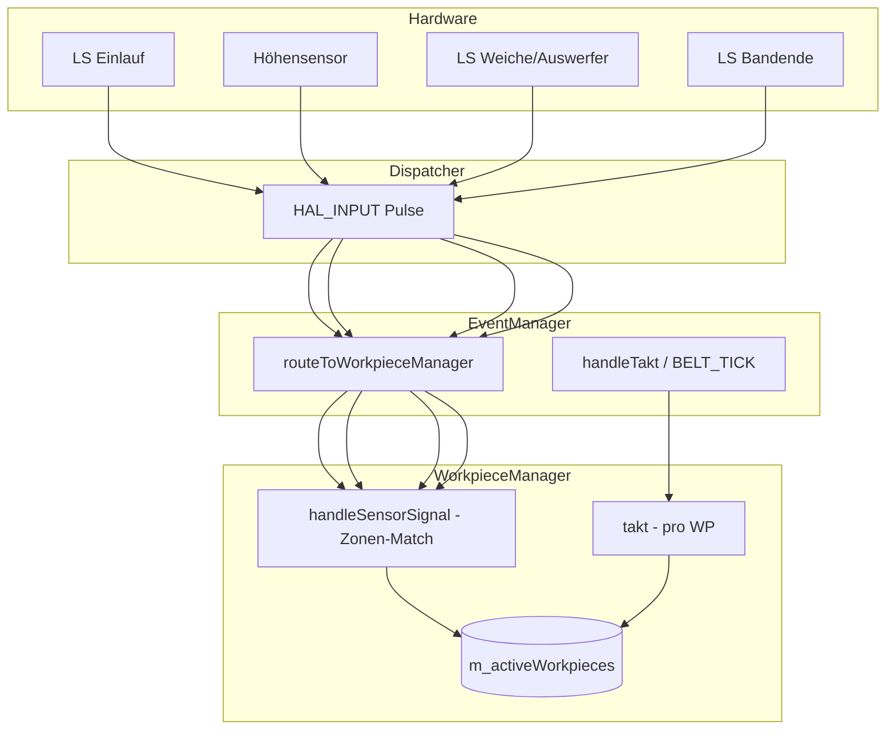
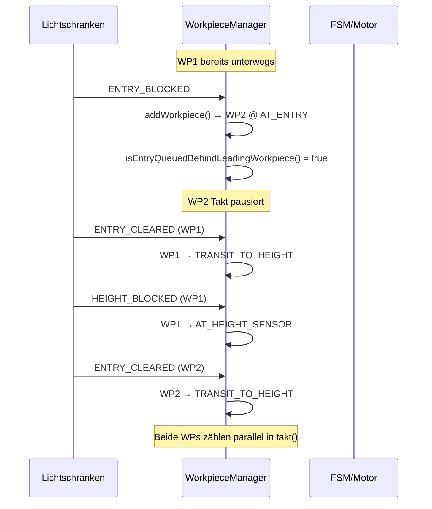

# WP-Tracking-Konzept (Mehrere Werkstücke auf dem Band)

SoSe2026 Team 3.3 — Schieberegister / Digitaler Zwilling im `WorkpieceManager`.

Verwandte Dokumente: [CONNECTION_KONZEPT.md](CONNECTION_KONZEPT.md), [UEBERGABE_KONZEPT.md](UEBERGABE_KONZEPT.md)

---

## Grundidee

Das System kennt **kein einzelnes** Band-Werkstück, sondern verwaltet **alle aktiven Teile parallel** in einer Liste:

```cpp
std::vector<Workpiece> m_activeWorkpieces;  // Schieberegister
```

Jedes `Workpiece` ist ein **Digitaler Zwilling**: ID, Typ, Zone (`WpLocation`), eigener Taktzähler und eigenes Timeout-Limit.

**Physik** läuft parallel (mehrere Teile gleichzeitig auf dem Band).  
**Logik** ordnet Sensor-Events dem **vordersten WP in der erwarteten Zone** zu.

```
Einlauf ──► HS ──► Weiche/Auswerfer ──► Bandende / Rutsche
  WP3        WP2       WP1                 WP0
 (AT_ENTRY) (TRANSIT) (AT_EJECTOR)        (AT_END)
```

---

## Datenmodell (`Workpiece`)

| Feld | Bedeutung |
|------|-----------|
| `m_id` | Eindeutige ID (A1: auto-increment; A2: von Partner übernommen) |
| `m_type` | Finaler Typ (Rezept / Sortierung) |
| `m_partnerType` | Von A1 übertragener Typ (A2) |
| `m_measuredType` | Durch Höhen-/Metallsensor gemessen |
| `m_location` | Aktuelle Zone auf dem Band |
| `m_ticksInCurrentState` | Verbrauchte 10-ms-Takte in dieser Zone |
| `m_targetLimitForState` | Kalibriertes Timeout-Limit für diese Zone |
| `m_normalEquivalentConsumed` | Zurückgelegte Strecke in Normal-Takten (Motorwechsel) |
| `m_isCorrectInSequence` | Passt zum Rezept an der Weiche? |
| `m_entryBlockedSeen` | Physische ENTRY_BLOCKED-Flanke gesehen? |
| `m_metalDetected` | Metallsensor hat WP erfasst |

**Zonenwechsel** (`updateLocation`) setzt Takte und Limits **pro WP** auf 0 zurück.

---

## Band-Zonen (`WpLocation`)

Reihenfolge auf dem Förderband (Anlage 1 und 2, ohne Rutsche vs. Bandende):

```
AT_ENTRY
  ↓ ENTRY_CLEARED
TRANSIT_TO_HEIGHT
  ↓ HEIGHT_BLOCKED
AT_HEIGHT_SENSOR
  ↓ HEIGHT_CLEARED (+ Typ-Messung)
TRANSIT_TO_EJECTOR
  ↓ EJECTOR_BLOCKED
AT_EJECTOR          ← Sortierentscheidung (Weiche / Auswerfer)
  ↓ EJECTOR_CLEARED
TRANSIT_TO_CHUTE ──► AT_CHUTE        (Aussortierung, WP verlässt Register)
        oder
TRANSIT_TO_END ──► AT_END          (Bandende / Übergabe an A2)
  ↓ END_CLEARED
( WP aus Register entfernt )
```

| Zone | Takt-Zählung | Timeout |
|------|--------------|---------|
| `AT_ENTRY` | Ja (wenn nicht in Warteschlange) | Entry-Timeout |
| `TRANSIT_TO_*` | Ja (Motor an) | WP_LOST |
| `AT_HEIGHT_SENSOR` | Ja (Motor an) | STUCK |
| `AT_EJECTOR` | Ja (Motor an) | STUCK |
| `AT_END` / `AT_CHUTE` | Nein | — |

---

## Mehrere WPs — wie funktioniert das?

### 1. Liste statt Einzel-Slot

- Jedes neue Teil wird mit `addWorkpiece()` (A1) oder `addNetworkWorkpiece()` (A2) **hinten** in `m_activeWorkpieces` eingefügt.
- **Mehrere WPs** können gleichzeitig in **verschiedenen Zonen** sein.
- Es gibt **kein hartes Maximum auf A1** (nur Bandlänge physisch).
- **Anlage 2:** max. **2 aktive WPs** (`kMaxActiveWorkpiecesAnlage2`), inkl. pending Netzwerk-Übergabe.

### 2. Event-Zuordnung: „Erstes WP in Zone X“

Sensor-Events werden nicht global, sondern **zonenbasiert** zugeordnet:

```cpp
Workpiece* wp = getFirstWorkpieceAt(WpLocation::TRANSIT_TO_HEIGHT);
// → erstes WP in der Liste mit dieser Location
```

| Event | Erwartete Zone des WP |
|-------|------------------------|
| `ENTRY_CLEARED` | `AT_ENTRY` |
| `HEIGHT_BLOCKED` | `TRANSIT_TO_HEIGHT` |
| `HEIGHT_CLEARED` | `AT_HEIGHT_SENSOR` (Fallback: `TRANSIT_TO_HEIGHT`) |
| `EJECTOR_BLOCKED` | `TRANSIT_TO_EJECTOR` |
| `EJECTOR_CLEARED` | `AT_EJECTOR` |
| `END_BLOCKED` | `TRANSIT_TO_END` |
| `END_CLEARED` | `AT_END` |
| `CHUTE_BLOCKED` | `TRANSIT_TO_CHUTE` |

> **Wichtig:** Kommt ein Event, aber **kein WP** in der erwarteten Zone → `UNEXPECTED_EVENT` oder Ignorieren (je nach Kontext).

### 3. Beispiel: 3 WPs auf A1

```
Zeit →
Band:  [WP1 @ AT_EJECTOR][WP2 @ TRANSIT_TO_HEIGHT][WP3 @ AT_ENTRY]
```

- **WP1** wartet an Weiche (Sortierentscheid, eigener Takt-Zähler).
- **WP2** fährt zum Höhensensor (`SET_SLOW` kann aus WP2 ausgelöst werden).
- **WP3** steht am Einlauf — Takt-Zähler **pausiert**, solange vorausfahrendes WP noch nicht weit genug ist (siehe Warteschlange).

Jeder 10-ms-`BELT_TICK` ruft `takt()` auf → **alle relevanten WPs** werden unabhängig hochgezählt.

---

## Warteschlange am Einlauf

Zweites (drittes, …) WP am Einlauf darf **nicht** schon „mitfahren“, solange ein **führendes WP** weiter vorne ist:

```cpp
bool isEntryQueuedBehindLeadingWorkpiece()
```

Ein WP an `AT_ENTRY` ist **in Warteschlange**, wenn ein anderes WP bereits in einer „späteren“ Zone ist (`TRANSIT_TO_HEIGHT` … `AT_END`).

| Verhalten | Bedeutung |
|-----------|-----------|
| `wp.resetTicks()` in `takt()` | Einlauf-WP zählt nicht, solange Warteschlange |
| `EARLY_ENTRY` Fehler | Neues WP am Einlauf, obwohl Einlauf noch „belegt“ und vorderes WP noch vor HS |
| `ENTRY_CLEARED` für WP2 | Erst wenn WP2 wirklich an der LS und vorderes WP unterwegs |

---

## Lebenszyklus eines WPs (Anlage 1)

### Anlegen

1. `ENTRY_BLOCKED` + Einlauf frei + LS physisch blockiert → `addWorkpiece()`
2. WP startet in `AT_ENTRY` mit Limit `ticks_EntryB_to_EntryC_Normal`
3. `MOTOR_RUN` (FSM) — Band fährt

### Durchlauf

| Schritt | Event | Aktion |
|---------|-------|--------|
| Einlauf verlassen | `ENTRY_CLEARED` | → `TRANSIT_TO_HEIGHT`, Limit aus Kalibrierung |
| Vor HS | `takt`: Tick == `setSlowTick` | `SET_SLOW` für dieses WP |
| Am HS | `HEIGHT_BLOCKED` | → `AT_HEIGHT_SENSOR`, Mess-Timeout |
| Typ gemessen | `HEIGHT_CLEARED` / ADC | → `TRANSIT_TO_EJECTOR`, ggf. `SET_FAST` |
| An Weiche | `EJECTOR_BLOCKED` | → `AT_EJECTOR`, Sortierentscheid |
| Passiert | `EJECTOR_CLEARED` | → `TRANSIT_TO_END`, Rezept `advanceSequence()` |
| Bandende | `END_BLOCKED` | → `AT_END`, Übergabe an A2 (siehe UEBERGABE_KONZEPT) |
| Verlassen | `END_CLEARED` | `removeWorkpiece()` |

### Entfernen aus Register

- **Rutsche:** `CHUTE_BLOCKED` → sofort `removeWorkpiece()`
- **Bandende A1:** nach erfolgreicher Übergabe + `END_CLEARED`
- **Bandende A2:** `END_CLEARED` nach Durchlauf
- **Fehler:** WP_LOST / STUCK → Eskalation, ggf. Register bereinigt
- **Geister-WP:** Einlauf-LS frei ohne `ENTRY_CLEARED` → `discardGhostEntryWorkpieceIfSensorClear()`

---

## Lebenszyklus (Anlage 2)

1. WP kommt per **Netzwerk-Übergabe** (`WP_INFO` → pending → `ENTRY_BLOCKED` → `addNetworkWorkpiece()`)
2. Gleicher Zonen-Durchlauf wie A1 (ohne erneutes `addWorkpiece()` am Einlauf)
3. Typ kommt von Partner (`partnerType`), Messung am HS kann Typ verfeinern
4. Am Bandende: `END_BLOCKED` / `END_CLEARED` — kein REQ/READY, sondern lokaler Betrieb
5. **Mindestabstand Übergabe:** Wenn WP am HS (`HEIGHT_BLOCKED`), darf A2 wieder `READY_TO_RECEIVE` senden (nächste Übergabe von A1 möglich)

---

## 10-ms-Takt (`takt()`)

Auslöser: QNX-Timer `BELT_TICK` (10 ms) → `EventManager::handleTakt()` → `WorkpieceManager::takt(isMotorSlow)`.

**Pro WP und Takt:**

```
Motor aus?        → keine Transit-Takte (Ausnahme: HS/Ejector-STUCK-Check teils mit motorOn)
AT_END/AT_CHUTE?  → kein Zählen
AT_ENTRY + Queue? → resetTicks(), kein Zählen
Sonst             → incrementTicks(), Timeout prüfen
```

**Timeout-Toleranz:** `kTimeoutToleranceTicks = 5` (50 ms extra über Limit)

| Fehler | Zone typisch |
|--------|----------------|
| `WP_LOST` | TRANSIT_* (Teil nicht rechtzeitig angekommen) |
| `STUCK` | AT_HEIGHT_SENSOR, AT_EJECTOR |
| `ENTRY`-Timeout | AT_ENTRY (EntryB→EntryC überschritten) |

---

## Motor Slow / Fast bei mehreren WPs

### `shouldUseSlowMotor()`

Prüft **alle** aktiven WPs — reicht **ein** WP in Slow-Zone:

- `TRANSIT_TO_HEIGHT` mit `ticks >= setSlowTick`
- `AT_HEIGHT_SENSOR`
- `TRANSIT_TO_CHUTE`

→ Motor soll **Slow** laufen (FSM / `SET_SLOW`).

### `hasWorkpiecesNeedingMotor()`

Motor muss laufen, solange **irgendein** WP in Transit- oder Mess-Zonen ist (nicht nur `AT_END` / `AT_CHUTE`).

→ Verhindert `MOTOR_STOP`, während hinten noch Teile unterwegs sind.

### Pro-WP-Limits bei Motorwechsel

Jedes WP hat **eigenes** `targetLimit`, berechnet aus Kalibrierung + aktuellem Motor (Normal/Slow) + Sicherheits-Ticks. Motorwechsel bei WP2 beeinflusst nicht das Limit von WP1 in anderer Zone (eigene `applySegmentTargetLimit` / `recalculateTargetLimitAfterMotorChange`).

---

## Rezeptur (`TargetSequence`)

Zyklisches Soll-Rezept (Ringpuffer):

1. `TALL_DRILLED`
2. `TALL_METAL`
3. `FLAT`
4. `TALL_DRILLED_METAL`

| Aktion | Wann |
|--------|------|
| `isCorrectType()` | Sortierentscheid an Weiche |
| `advanceSequence()` | Nach erfolgreicher Passage (`EJECTOR_CLEARED`, korrekt) |
| `forceType()` | Nach Netzwerk-Sync (A2 → A1) oder Fehlerkorrektur |

Jedes WP trägt `m_isCorrectInSequence` — mehrere WPs können unterschiedliche Rezept-Status haben.

---

## Sortierung (Weiche / Auswerfer)

An `AT_EJECTOR`:

- **Korrekt im Rezept** → Weiche offen / Passage → `TRANSIT_TO_END`
- **Falsch** → Rutsche / Auswerfer → `TRANSIT_TO_CHUTE`
- **Metall-Erkennung** kann Typ upgraden (z. B. TALL → TALL_METAL)
- **`m_pendingEjectorBlockedAfterHeight`:** EJECTOR-LS kam vor `HEIGHT_CLEARED` → nach HS nachziehen (Mehrfach-WP / schnelles Band)

Mehrere WPs: Sortier-LS ist **einem WP zugeordnet** (`m_ejectorBlockedWpId`); doppelte Flanken werden ignoriert.

---

## Kapazität & Abstände

| Regel | Wert / Verhalten |
|-------|------------------|
| Max. WPs A2 | 2 (inkl. pending Übergabe) |
| Max. WPs A1 | Kein explizites Software-Limit |
| Einlauf-Warteschlange | Nur ein „aktives“ Einlauf-WP zählt Takte |
| Übergabe Mindestabstand A2 | WP muss HS passiert haben, bevor neues READY |
| Bandende A1 belegt | Neues WP am Einlauf möglich, Motor wartet (`entryDeferredWhileEndBlocked`) |

---

## Fehlerbilder (Mehrfach-Betrieb)

| Situation | Reaktion |
|-----------|----------|
| `HEIGHT_BLOCKED` ohne WP in `TRANSIT_TO_HEIGHT` | UNEXPECTED_EVENT (Manipulation / unregistriertes Teil) |
| Doppelte `HEIGHT_BLOCKED` | Ignoriert (Messung läuft für WP1) |
| `ENTRY_BLOCKED` während WP1 noch vor HS | EARLY_ENTRY |
| `EJECTOR_BLOCKED` vor `HEIGHT_CLEARED` | Gepuffert (`m_pendingEjectorBlockedAfterHeight`) |
| Geister-WP am Einlauf | Entfernen wenn LS physisch frei |
| WP1 an `AT_END`, WP2 unterwegs | Motor läuft weiter (`hasWorkpiecesNeedingMotor`) |

---

## Datenfluss (Übersicht)



---

## Sequenzdiagramm — 2 WPs auf A1



---

## Verantwortlichkeiten

| Komponente | WP-Tracking-Aufgabe |
|------------|---------------------|
| **Timer** | `BELT_TICK` alle 10 ms |
| **EventManager** | Sensor → WP-Manager, `addWorkpiece()`, Motor-FSM |
| **WorkpieceManager** | Schieberegister, Zonen, Timeouts, Rezept |
| **Workpiece** | Digitaler Zwilling (DTO) |
| **ErrorHandler** | WP_LOST, STUCK, UNEXPECTED_EVENT |
| **CalibrationManager** | Limits pro Segment (Normal/Slow) |
| **Dispatcher** | Nur Sensor-Events, kein Tracking |

---

## Konstanten (Auszug)

| Konstante | Wert | Bedeutung |
|-----------|------|-----------|
| `BELT_TICK` | 10 ms | Taktperiode |
| `kTimeoutToleranceTicks` | 5 | Timeout-Toleranz |
| `kHandoverEntryTimeoutTicks` | 300 | A2: WP_INFO → ENTRY (3 s) |
| `kMaxActiveWorkpiecesAnlage2` | 2 | Max. WPs auf A2 |
| `kSetSlowFactor` | 0.65 | Slow-Umschaltpunkt Entry→Height |
| `kTransitToHeightSafetyTicks` | 50 | Sicherheitsaufschlag Limit |
| `kSwitchOpenHoldTicks` | 150 | Weiche offen (1,5 s) |

---

## Merksätze

1. **Schieberegister** — `vector<Workpiece>`, nicht ein einzelnes Band-Slot.
2. **Ein WP = eine Zone + eigene Takte + eigenes Limit.**
3. **Sensor-Event → erstes WP in erwarteter Zone** — nicht „irgendein“ WP.
4. **Mehrere WPs zählen parallel** im 10-ms-`takt()`, Einlauf-Warteschlange ausgenommen.
5. **Motor läuft**, solange **irgendein** WP Transit braucht (`hasWorkpiecesNeedingMotor`).
6. **Slow/ Fast** hängt vom **vordersten relevanten** WP ab (`shouldUseSlowMotor`).
7. **A2 max. 2 WPs** — A1 theoretisch unbegrenzt (Bandlänge ist die Grenze).
8. **ID bleibt über Übergabe** — A2 übernimmt A1-ID für durchgängiges Tracing.

---

## Dateiübersicht

```
src/
├── shared/types.hpp                 # WpType, WpLocation
├── timer/timer.cpp                  # BELT_TICK (10 ms)
├── logik/
│   ├── eventManager/eventManager.cpp  # Routing, addWorkpiece, MOTOR_RUN/STOP
│   ├── errorHandler/errorHandler.cpp  # Timeouts, STUCK, WP_LOST
│   └── workpieceManager/
│       ├── Workpiece.hpp              # Digitaler Zwilling (DTO)
│       ├── WorkpieceManager.cpp       # Schieberegister, takt(), Sensor-Zuordnung
│       ├── workpieceManager.hpp
│       └── targetSequence.hpp         # Rezept-Ringpuffer
└── docs/
    ├── UEBERGABE_KONZEPT.md           # A1 → A2 am Bandende
    └── CONNECTION_KONZEPT.md          # Netzwerk-Voraussetzung
```
